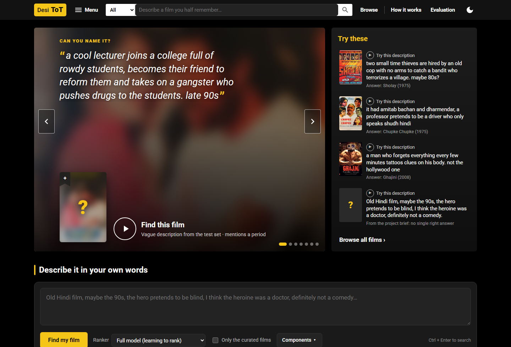
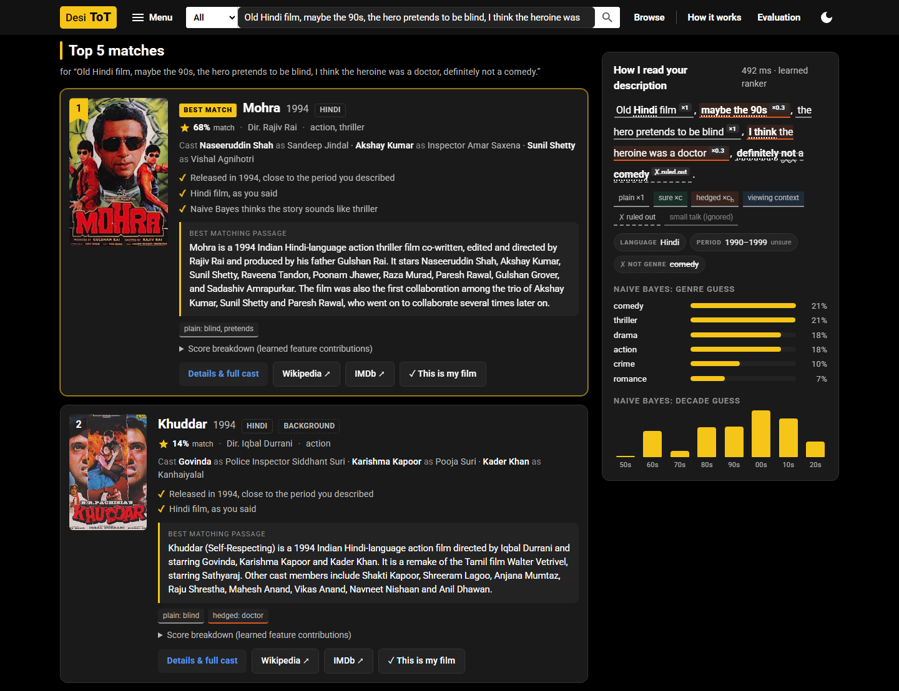
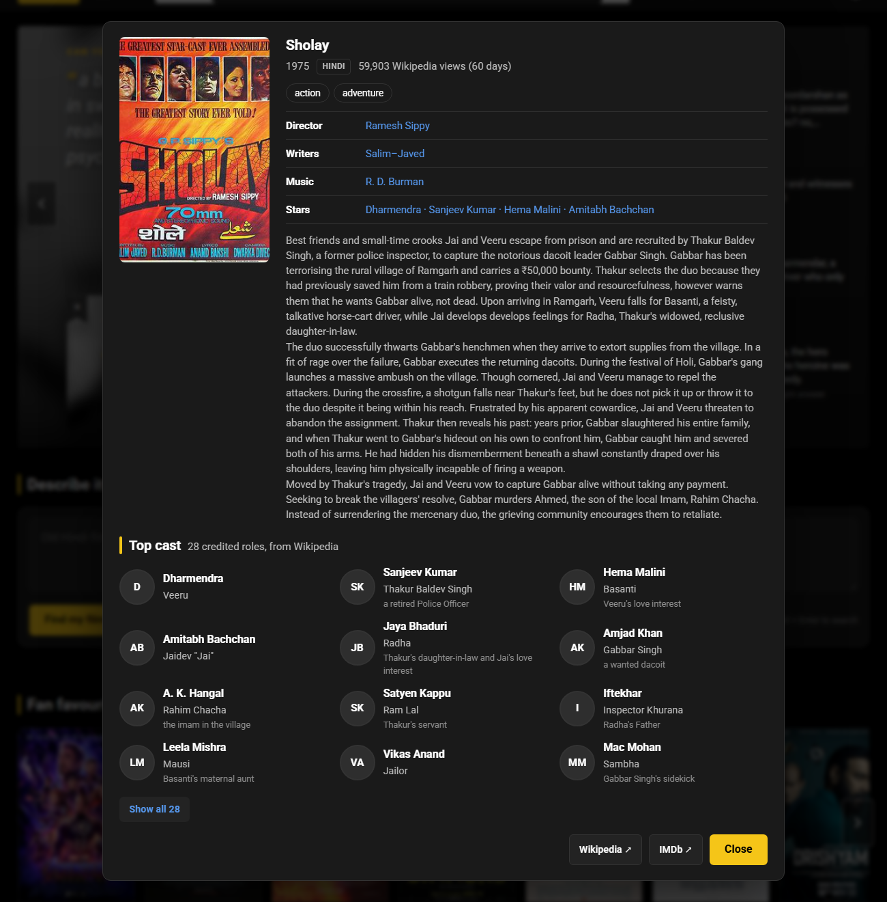

# Desi ToT — Half-Remembered, Fully Found

**Tip-of-the-tongue search for Hindi, Telugu and English films.** Describe a film you can't name — hedge,
misremember, rule things out ("maybe the 90s, the hero pretends to be blind, I think the heroine was a doctor,
definitely not a comedy") — and get the five most likely films with their release posters and an explanation
of why each one matched.



| | |
|---|---|
| Films | **830 curated** (330 Hindi · 250 Telugu · 250 English: cult classics, critics' favourites, box-office record breakers), built up in batches: the original 200 Hindi / 50 Telugu / 50 English, **50 famous 1990–2026 films** (tag `added`), **50 more Hindi films from 1980–2026** (`hindi50`), **140 Telugu + 140 English popular, highly rated 1990–2026 films** (`te140`, `en140`) and **50 Hindi + 50 Telugu + 50 English films from 2000–2026** (`add150`); + **419 distractor films** sampled from Wikipedia year categories; all with posters, plots and Wikipedia links, and IMDb links (from Wikidata) for 1,248 of all 1,249 films |
| Cast | every film's Wikipedia cast list parsed into **actor → character → role** ("Amjad Khan as Gabbar Singh, a dacoit"): list templates, cast tables and dual roles; 16,100 character names for the curated films |
| Queries | 830 detailed + 830 vague LLM-written ToT queries (one of each per curated film), an 830-query false-memory stress test, and a slot for your team's human-written queries |
| Retrieval | inverted index with **BM25F** · **TF-IDF cosine** · dense **bge-small** embeddings · **clause weighting** for hedged/confident/context/small-talk statements · **scope-aware negation** (incl. "not Race 2" = only the sequel) · **Hinglish** spelling handling · **Naive Bayes** genre/decade soft filters · **PageRank & HITS** · **learning to rank** |
| Evaluation | MRR, Success@k, P@k, R@k, F1@k, nDCG@10/@all, 95% bootstrap CIs, paired randomisation tests, ablation study, comparison with the TREC 2025 ToT track |

---

## 1. Run the web app

Everything the app needs is already built in `data/` (corpus, posters, index, trained model), so no crawling or
training is needed to run it. You need **Python 3.10 or newer** (tested with 3.13) and about 1.5 GB of disk space
for the Python packages.

**Windows (PowerShell or Command Prompt), from the project folder:**

```bat
python -m venv .venv
.venv\Scripts\activate
pip install -r requirements.txt
python web\app.py
```

**macOS / Linux:**

```bash
python3 -m venv .venv
source .venv/bin/activate
pip install -r requirements.txt
python web/app.py
```

Wait for `Engine ready: 1249 films ...` and `Running on http://127.0.0.1:5000`, then open
<http://127.0.0.1:5000> in a browser. Stop the server with **Ctrl + C**.

- **First start:** the sentence-embedding model (BAAI/bge-small-en-v1.5, ~130 MB) is downloaded once from
  Hugging Face, which needs internet; later starts work offline and take about 30 seconds. Without the model the
  app still runs, with dense retrieval switched off.
- **Port already in use:** `python web/app.py --port 5055`. To open it from another device on your network:
  `python web/app.py --host 0.0.0.0` (then use your computer's IP address).
- **Later sessions:** activate the environment again (`.venv\Scripts\activate`) and run `python web\app.py`.

**Using the app.** Type a description in the top search bar (the **All ▾** menu restricts results to Hindi, Telugu
or English) or in the larger *Describe it in your own words* box, and press Enter / **Find my film**.
The **Can you name it?** banner cycles through real descriptions from the test set: click the blurred poster to
reveal the film, or ▶ to search. **Try these** has ready-made examples. Each of the top 5 results shows the poster,
a ★ match score, director, top cast with character names, why it matched and the best matching plot passage;
**Details & full cast** opens the film page with the complete cast list (actor, character, role); results and film
pages link to the film's **Wikipedia ↗** and **IMDb ↗** pages. The panel on the
right shows how the description was read (hedges, exclusions, decade, names, Naive Bayes guesses).
The **Fan favourites** row lists the 24 curated films with the most English-Wikipedia page views over the 60 days
before each article was downloaded (7 September–5 November 2026, or a day later for the films added last).
**Browse** lists all 830 curated films (filters: language, decade, sort, title);
**How it works** explains the method and **Evaluation** shows every result table and figure.
Links like `http://127.0.0.1:5000/?q=a+fly+takes+revenge&lang=te` run a search directly, and
`/?film=<id>` opens a film page.





## 2. Rebuild everything from scratch (optional)

```bash
python scripts/crawl.py all          # Wikipedia: resolve titles, sample distractors, wikitext, posters (~25 min)
python scripts/build_corpus.py       # wikitext -> data/corpus/films.json
python scripts/build_index.py        # BM25F index, entities, Naive Bayes, PageRank/HITS, embeddings (~10 min on CPU)
python scripts/evaluate.py           # every experiment + final model for the app (~20-30 min; keep the laptop awake)
python scripts/evaluate_novelty.py   # the four evidence checks C1-C4 (~25 min) -> results/novelty_*.{md,json,csv}
python scripts/make_figures.py       # results/figures/*.png
```

**Adding more films later** (this is how every batch after the first was added). Append rows to `data/seed_films.csv`
(`lang,title,year,tags,priority,wiki_hint`, priority 1), raise `TARGET` in `scripts/build_corpus.py`, then run
`python scripts/crawl.py resolve fetch people posters imdb`
(only new films are downloaded; `imdb` looks up IMDb ids on Wikidata), `build_corpus.py` and `build_index.py`
(embeddings of unchanged plots are reused, so this takes a few minutes). Add one detailed and one vague query per new film to `data/queries/` so the evaluation
covers them, and re-run `evaluate.py`.

Wikimedia limits clients **without contact details in their User-Agent to 10 requests/minute** (2026 policy).
The crawler is designed for that limit (50 articles per request, ~150 requests in total). To identify your
crawler and get the 200/minute limit, set `DESITOT_CONTACT` to your own e-mail or project URL first:
`set DESITOT_CONTACT=you@example.com` (Windows) / `export DESITOT_CONTACT=...` (macOS/Linux).

## 3. How it works

```
OFFLINE  Wikipedia crawl -> wikitext parsing -> tokenise/stop/stem -> inverted index (BM25F, TF-IDF)
                                                                    -> passage embeddings (bge-small)
                                                                    -> Naive Bayes genre & decade models
                                                                    -> link graph -> PageRank, HITS
                                                                    -> entity lexicon (names, phonetic keys)
ONLINE   query -> clause splitter (plain / hedged / confident / context / small talk / exclusion)
               -> Hinglish layer (name matching, phonetic spelling fixes, Hinglish->English lexicon)
               -> 22 features per film -> learning-to-rank model
               -> evidence checks: C1 borrowed memories · C3 event order · C2 remakes & dubs · C4 one question
               -> top 5 + explanations
```

### Evidence checks: telling a wrong memory from a correct memory of another version

Certainty weights can only scale a clue up or down, so "I'm certain Akshay Kumar was in it" is trusted *more* than
"maybe Akshay Kumar was in it", even when he was in a different film. Four checks on top of the ranker
(`desitot/conflicts.py`, `versions.py`, `order.py`, `questions.py`; switch them off under *Components*):

- **C1 · Memories borrowed from another film.** Each clue (an actor mentioned in a short clause, or the plot clauses of
  one sentence) gets a support score for every film: exact for actors (the parsed cast lists), BM25F + dense
  similarity for scenes. The ranker is re-run without the clue to see which film the rest of the description agrees on;
  a clue that fits another film far better is flagged and the film it probably comes from is named. When several clues
  disagree, the side with clearly more evidence wins (content words × support; a hedged detail counts half, certainty
  never counts extra): the other side's clues are withdrawn. When the sides are balanced, both films are shown at the
  top and the one-question step settles it.
- **C2 · Remakes and dubbed versions.** Remake sentences in the articles ("remade in Hindi as Kabir Singh (2019)",
  "a remake of the 2016 Hindi film Pink") join 36 films into 18 stories (`data/index/stories.json`); dub mentions
  give each film's dub languages. "I watched it in Hindi" counts as evidence for a Hindi version *or* a Hindi dub,
  actor clues are checked against each version's cast, and when two versions still fit, both are kept at the top.
- **C3 · Scenes in the order you remember.** Events joined by "and then", "later", "in the end" ("before that"
  reverses them) are matched to plot passages; a film whose plot has them the other way round gets a small penalty,
  and each result shows the two passages in sequence (with a button to reverse the events).
- **C4 · One question.** When the top films stay close, the system asks the question with the highest expected
  information gain × chance the viewer can answer it: decade, language, which of a few actors, which version, or
  what happened next. "I don't remember" is always allowed.

Results (`python scripts/evaluate_novelty.py` → `results/novelty_results.md`; the same queries through the deployed
ranker with and without each check):

| Check | Case it targets | Without | With |
|---|---|---|---|
| C1 | Accuracy (Success@1) on hedged false memories, 830 queries | 0.649 | 0.682 (p = 0.038; clue precision 0.89, recall 0.65, source film named 82.5%) |
| C2 | Right version first when a lead actor of only one version is named, 33 films | 0.758 | 0.909 |
| C3 | Target scores higher with events in plot order than reversed, 814 pairs | 0.525 | 0.972 |
| C4 | Expected accuracy on certain-but-wrong descriptions after one question, 830 queries | 0.484 | 0.711 (always asking the decade: 0.606) |

On ordinary vague descriptions MRR moves by at most 0.002 (0.921 → 0.919 with C1, p = 0.35). A wrong clue stated
plainly or with certainty is reported as a conflict rather than withdrawn (C1 recall 0.36–0.37), and the question
step resolves those. All test descriptions are LLM-written or synthetic, and C4 uses simulated viewers.

**Clause-weighted scoring with exclusions** (our core idea): each clause *j* gets a weight *c<sub>j</sub>*
(1 for plain memories, *c<sub>h</sub>* for hedged, *c<sub>conf</sub>* for confident, *c<sub>ctx</sub>* for viewing context,
0 for small talk); exclusions are penalised:

  *s(d) = Σ<sub>j</sub> c<sub>j</sub> · BM25F(clause<sub>j</sub>, d) − μ · Σ<sub>j</sub> c′<sub>j</sub> · BM25F(neg<sub>j</sub>, d)*

A negation counts as an **exclusion** only when it is about the film itself (its genre, language, decade, cast,
"it wasn't…", "not the remake"); plot negations ("he can't see", "nobody believes her") stay positive evidence.
Sequel numbers are part of a title's key, so "not Dhoom 3" rules out only *Dhoom 3*, and "the first one, not
Race 2" does not penalise *Race* (a title followed by a sequel number that is not in the index names another film).
*c<sub>h</sub>, c<sub>conf</sub>, c<sub>ctx</sub>, μ* are **learned** by cross-validated grid search.

**Cast, characters and roles.** `scripts/build_corpus.py` turns each Wikipedia cast section into
(actor, character, role) triples: `{{Cast list}}`/`{{castlist}}`/`{{div col}}` lists, cast tables
(Actor | Role | Notes), dual roles written as sub-bullets ("Sridevi in a dual role as: Anju … / Manju …"), "aka"
names, long role descriptions, and, for articles without a cast section, "Karthik (Naga Chaitanya)" in the plot.
Actor and character names feed the entity matcher (so "gabbar" or "rooh baba" find the film), the role
descriptions are indexed in the BM25F cast field, and results explain matches as "Amitabh Bachchan (as Jai)".

### Where each lecture concept lives in the code

| Concept (lecture) | File |
|---|---|
| Tokenising, case folding, diacritics, stop words, stemming (2–3) | `desitot/text.py` |
| Inverted index, posting lists (2) | `desitot/index.py` |
| tf, idf, vector space model, cosine similarity (6) | `desitot/index.py` (`tfidf_cosine`) |
| BM25 / BM25F (6) | `desitot/index.py` (`bm25`) |
| Clause splitting, hedge & negation handling, decade/language/genre cues | `desitot/query.py` |
| Hinglish phonetic keys, fuzzy names, spelling correction, lexicon | `desitot/hinglish.py` |
| Naive Bayes text classification | `desitot/nb.py` |
| PageRank and HITS (link analysis) | `desitot/graph.py` |
| Dense retrieval, hybrid rank fusion | `desitot/dense.py`, `desitot/engine.py` |
| Learning to rank (coordinate ascent, RankNet-linear, LambdaMART) | `desitot/ltr.py` |
| Evaluation: P@k, R@k, F1, MRR, MAP, nDCG, significance, Kendall's τ (8) | `desitot/metrics.py`, `scripts/evaluate.py` |
| Crawling | `scripts/crawl.py` |
| C1 borrowed-memory check (leave-one-clue-out, evidence consensus) | `desitot/conflicts.py` |
| C2 story clusters, dub languages, version resolution | `desitot/versions.py` |
| C3 ordered passage evidence | `desitot/order.py` |
| C4 question selection by expected information gain | `desitot/questions.py` |
| Evaluation of C1–C4 | `scripts/evaluate_novelty.py` |

## 4. Results

Index: 1249 films (830 curated). Queries: 830 detailed, 830 vague, 830 vague+noise.

**MRR by query condition** (5-fold cross-validation for every learned component):

| System | Detailed | **Vague (primary)** | Vague + false memories |
|---|---|---|---|
| BM25F (baseline) | 0.992 | 0.865 | 0.460 |
| TF-IDF cosine (VSM) | 0.976 | 0.753 | 0.349 |
| Dense bi-encoder (bge-small, MaxP) | 0.835 | 0.624 | 0.365 |
| BM25 + dense (RRF) | 0.946 | 0.813 | 0.492 |
| Clause-weighted BM25 (learned c_h, c_conf, c_ctx) | 0.991 | 0.865 | 0.672 |
| + scope-aware negation (learned mu) | 0.989 | 0.866 | 0.672 |
| + Hinglish spelling handling | 0.988 | 0.865 | 0.645 |
| Full LTR: coordinate ascent (ours) | 0.988 | 0.917 | 0.819 |
| Full LTR: pairwise logistic / RankNet-linear (ours) | 0.991 | 0.917 | 0.765 |
| Full LTR: LambdaMART (ours) | 0.991 | 0.917 | 0.830 |

On the primary (vague) set our coordinate-ascent ranker (the kind deployed in the app) finds the right film **first 88% of the time** (BM25: 82%) and in the **top 10 98%** of the time (BM25: 94%); MRR 0.917 vs 0.865, nDCG@10 0.932 vs 0.882 (paired randomisation test p < 0.001).

**Ablation (vague)**: full model retrained without one component:

| Variant | MRR | Δ MRR | p vs full |
|---|---|---|---|
| Full model | 0.917 | +0.000 | — |
| – clause weighting | 0.917 | +0.001 | 0.615 |
| – negation handling | 0.916 | -0.001 | 0.776 |
| – Hinglish handling | 0.915 | -0.001 | 0.657 |
| – dense retrieval | 0.901 | -0.015 | 0.002 |
| – Naive Bayes soft filters | 0.916 | -0.000 | 0.930 |
| – explicit cues (title/person/year/language/genre) | 0.901 | -0.016 | 0.002 |
| – PageRank / HITS / page views | 0.917 | +0.000 | 0.885 |

**Ablation (vague+noise)**: full model retrained without one component:

| Variant | MRR | Δ MRR | p vs full |
|---|---|---|---|
| Full model | 0.819 | +0.000 | — |
| – clause weighting | 0.769 | -0.050 | < 0.001 |
| – negation handling | 0.814 | -0.005 | 0.297 |
| – Hinglish handling | 0.814 | -0.005 | 0.338 |
| – dense retrieval | 0.792 | -0.027 | < 0.001 |
| – Naive Bayes soft filters | 0.817 | -0.002 | 0.642 |
| – explicit cues (title/person/year/language/genre) | 0.716 | -0.103 | < 0.001 |
| – PageRank / HITS / page views | 0.823 | +0.004 | 0.428 |

**Negation handling** (queries that rule something out; vague n = 59, detailed n = 147), MRR for none / drop / penalise every negation / **scope-aware (ours)**: vague 0.831 / 0.856 / 0.856 / **0.856**; detailed 0.975 / 0.966 / 0.965 / **0.972**.

**Naive Bayes** (5-fold CV on plots): decade accuracy 0.278 (majority baseline 0.248), macro-F1 0.220; genre top-1 accuracy 0.635, macro-F1@2 0.518.  
**Cue detection** (query level, 1660 annotated queries): hedges P 0.91 / R 0.95 / F1 0.93; exclusions P 0.89 / R 1.00 / F1 0.94.

**Comparison with TREC 2025 ToT** (Arguello et al., 2026): their BM25 reaches nDCG@1000 0.170 and the best run 0.682 on 6.4 M Wikipedia articles (a 4.0× gain over BM25). On our 1249-film index BM25 reaches 0.894 on vague queries and our full model 0.936; on the false-memory set 0.585 → 0.858. Absolute numbers are not comparable (search-space size); see `results/trec_comparison.md`.

**What the results say**

- **Clean, detailed queries are easy** (lexical methods 0.98–0.99 MRR): when people remember names, songs and dialogue, BM25 is enough.
- **Vague queries:** the learned rankers beat BM25 (0.865): coordinate ascent 0.917 (p < 0.001), RankNet-linear 0.917, LambdaMART 0.917. Dense retrieval alone is weak (0.624) yet removing it costs the ranker 0.015 MRR.
- **False memories are where the ideas pay off:** with one hedged false memory per query, clause weighting alone lifts MRR from 0.460 to 0.672 (the learned hedge weight drops to 0.0) and the full model reaches 0.819–0.830. Removing clause weighting costs 0.050 (p < 0.001) and removing the explicit cues 0.103 (p < 0.001).
- **Negation is the weakest part:** on queries that rule something out, scope-aware exclusions score 0.856 (vague) and 0.972 (detailed) against 0.856 and 0.975 for the best alternative, so on this query set it is no better than the simpler alternatives; inside the full ranker removing negation handling changes MRR by -0.001 (vague) and -0.005 (false memories, p = 0.297). The deployed model's weights on the exclusion features are -0.414 for languages ("not the Hindi dubbed one"), 0.000 for genres, -0.001 for names and titles and 0.000 for other ruled-out words: Wikipedia's generous genre labels (Sholay is filed under "buddy comedy") make "not a comedy" risky to enforce. A limitation worth discussing.
- **Naive Bayes** is a weak but useful prior: decade accuracy 0.278 vs 0.248 for the majority class, genre top-1 0.635.
- The **deployed model** (coordinate ascent) is trained on all 2490 LLM queries with two constraints that the cross-validated rankers above do not have. (1) The hedge weight is bounded below by 0.3 (learned: c_h = 0.3, c_conf = 1.25, c_ctx = 1.0, μ = 0.0): the false-memory set makes every hedged clause wrong, so unconstrained training would ignore hedges entirely, while real users' hedged memories are often right. (2) The five exclusion weights are kept ≤ 0, so ruling something out can only lower a film's score: many test descriptions rule out a sequel or remake whose title words also appear in the right film's article ("not Karthikeya 2"), and unconstrained training learned a small positive weight for ruled-out words, which put a comedy first for the project brief's "definitely not a comedy" example.

All learned components are evaluated with **5-fold cross-validation** (weights and models are fit on four
folds and tested on the fifth). Full tables: `results/main_results_*.md`, `results/ablation_*.csv`,
`results/negation_modes_*.csv`, `results/phenomena_*.csv`, `results/nb_eval.json`,
`results/cue_detection.json`, `results/trec_comparison.md`; per-query ranks: `results/per_query_*.csv`;
qualitative examples: `results/examples.md`; figures: `results/figures/`.

## 5. Adding human-written queries (LLM vs. human comparison)

The TREC 2025 ToT track found that system rankings on LLM-written queries track rankings on real queries
(Kendall's τ = 0.847). To repeat this for Indian films, **each team member describes films from memory**
(without looking anything up) in the web app and presses **"✓ This is my film"** on the right result (or "Tell us
which film you meant" if it isn't in the top 5; *Menu → Add your own test descriptions* explains it in the app).
Queries are appended to
`data/queries/human_queries.jsonl`. With 10 or more, re-run `python scripts/evaluate.py`: the human set is scored
with models trained only on the LLM queries, and Kendall's τ between the two system rankings is reported.

## 6. Material for each section of the report

| Report section | Where to find it |
|---|---|
| Literature review (5–7 papers) + novelty | `docs/papers.md` (section A, with a ready IEEE reference list) |
| Proposed model diagram | `results/figures/fig0_pipeline.png`, or the *How it works* tab |
| Methodology and formulas | §3 above, docstrings of `desitot/*.py` |
| Datasets | §1 table above, `data/seed_films.csv`, `data/corpus/films.json`, `data/queries/README.md` |
| Results: tables and graphs | `results/main_results_*.md`, `results/figures/fig1–fig9`, the *Evaluation* tab |
| Precision / recall / accuracy / F1 | P@10, R@10 (= Success@10), F1@10 and accuracy (= Success@1) in the main tables; Naive Bayes and cue-detector P/R/F1 in `nb_eval.json`, `cue_detection.json` |
| Comparison with an existing paper | `results/trec_comparison.md` (TREC 2025 ToT track, Table 1) |
| Ablation study | `results/ablation_vague.csv`, `results/ablation_vague_noise.csv`, `fig4_ablation.png` |

## 7. Limitations

- **Small search space.** 1,249 films versus 6.4 million Wikipedia articles in TREC, so absolute scores are much
  higher than TREC's; compare *gains over the BM25 baseline*, not raw numbers.
- **LLM-written test queries.** Written by an LLM that knows these films, so they are cleaner than real requests.
  The vague set and the false-memory set approximate real difficulty; human queries are the real test.
- **Injected false memories are adversarial.** The noisy condition copies a real plot sentence from another
  film, which is harsher than most real false memories.
- **Rule-based cue detection.** Hedge and negation cues come from lexicons (CoNLL-2010 / NegEx style); unusual
  phrasing is missed, and Wikipedia's generous genre labels can clash with a user's "not a comedy".
- **English plots only.** Hindi and Telugu Wikipedia articles and native-script queries (Devanagari, Telugu)
  are not indexed.
- **Posters** are Wikipedia's low-resolution fair-use images, stored locally for this academic project only.

**Possible extensions (not implemented):** *LLM query expansion*: ask an LLM for candidate titles, look them up
with the entity matcher, and add a "proposed by the LLM" feature to the learned ranker. *Pseudo-relevance
feedback*: Rocchio/RM3 expansion from the top-k films (likely to drift on ToT queries, which makes it a good
ablation). *Native-script queries*: transliterate Devanagari/Telugu input before matching.

## 8. Project layout

```
desitot/            the search engine (text, index, query, hinglish, nb, graph, dense, ltr, engine, metrics)
scripts/            crawl.py, build_corpus.py, build_index.py, evaluate.py, make_figures.py
web/                app.py (Flask) + static/ (index.html, app.js, style.css)
data/seed_films.csv curated film list (title, year, language, cult/acclaimed/blockbuster tags)
data/corpus/        films.json (1,249 films, incl. cast_roles, IMDb ids)   data/posters/   poster thumbnails
data/index/         BM25F index, embeddings, NB, graph, learned weights and ranker
data/queries/       LLM-written and human-written evaluation queries
results/            tables, per-query ranks, figures, summary.json
docs/papers.md      annotated bibliography + reference list
```

Wikipedia text is CC BY-SA 4.0. Built as an Information Retrieval course project.
